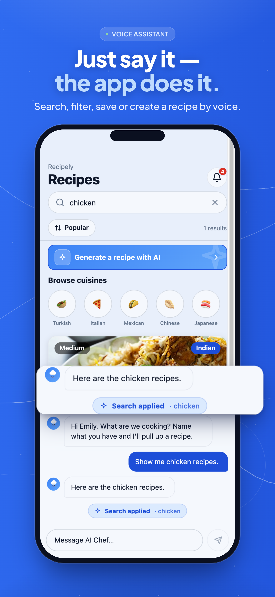
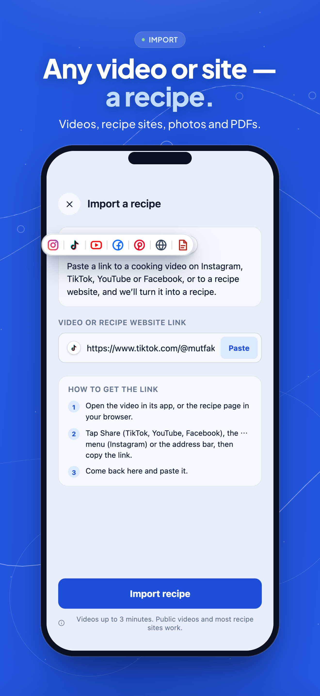
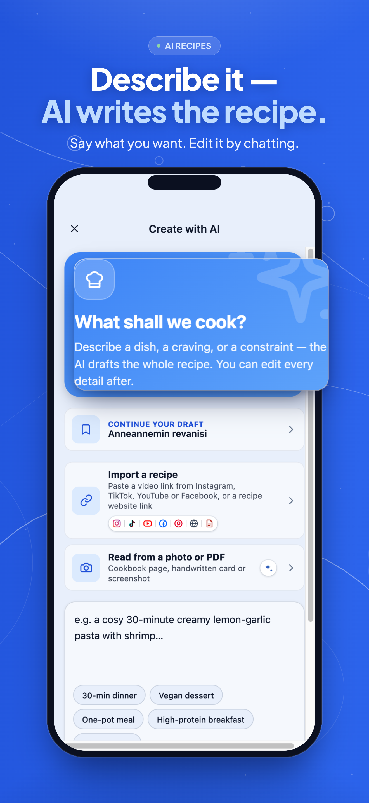

<div align="center">


# Recipely

**Talk, import, cook.** A recipe app for iOS, Android and the web, built from one codebase.
Import a recipe from any video, site, photo or PDF, have AI write one for you, and cook it with a
voice assistant that uses the app on your behalf.

[](https://expo.dev)
[](https://reactnative.dev)
[](https://react.dev/learn/react-compiler)
[](#checking-your-work)
[](#checking-your-work)
[](#license)

[**recipely.net**](https://recipely.net) · [About](https://recipely.net/about) · [App Store](https://apps.apple.com/us/app/recipely/id6787391255) · [Google Play](https://play.google.com/store/apps/details?id=com.recipely.app)

&nbsp;
&nbsp;


</div>

## Contents

- [What it does](#what-it-does)
- [How it is built](#how-it-is-built)
- [Getting started](#getting-started)
- [Checking your work](#checking-your-work)
- [Where things are](#where-things-are)
- [Shipping](#shipping)
- [Roadmap](#roadmap)
- [Contributing](#contributing)
- [Security](#security)
- [License](#license)

## What it does

| | |
|---|---|
| **Discover** | A recipe feed with search, filters and sorting, cuisines and trending recipes. Guests can browse without an account. |
| **Import** | Share a recipe from Instagram, TikTok, YouTube, Facebook or Pinterest, paste any recipe website, or photograph a cookbook page or pick a PDF. The app turns it into a structured recipe with a link back to the source. |
| **Create with AI** | Describe a dish or list what is in your fridge; AI drafts the recipe, and you refine it by chatting. |
| **Voice assistant** | Tap the chef and talk. It searches, filters, opens and creates recipes on screen while you watch, and answers out loud. Siri and Android shortcuts reach it too. |
| **Cook** | Ingredient checklist, numbered steps, timers inside the step that mentions them, a cooking mode, and metric/US units. |
| **Plan and shop** | Plan the week from saved recipes and get one shopping list. The shopping list and saved recipes open offline. |
| **Track** | A food diary with nutrition per 100 g or per serving. |
| **Creators** | Creator pages, creator tags, stats, and Instagram comment-to-DM recipe delivery. |
| **Everywhere** | Four themes with light and dark modes, 14 languages, and a web app with its own desktop layout and prerendered recipe pages. |

The app talks to its own API at `api.recipely.net` (the separate `recipely-backend` repository),
and uses Firebase for Google and Apple sign-in, push, analytics and crash reports.

## How it is built

Five layers. A layer may use the layers below it, never the ones above. Every layer may use **core**.

```
presentation   screens, widgets, page hooks, theme, translations
     ↓
application    stores (Zustand) and use cases: one class per thing a user can do
     ↓
domain         entities and value objects with their rules; ports (interfaces) for the outside world
     ↑ implemented by
infrastructure the API client and repositories, encryption, secure storage, Firebase,
               notifications, audio, ads, device, the Siri and Android bridges
─────────────────────────────────────────────────────────────────────────────────────────
core           Result, Failure, base entity and value object, the DI container, constants
               (used by every layer above)
```

The ideas behind it:

- **Dependencies point down.** A screen never calls the API; it calls a store, which calls a use case,
  which asks a port. `check:structure` fails a commit that imports the wrong way.
- **Ask for an interface, get an implementation.** Use cases depend on ports such as
  `FavoritesRepositoryInterface`; the DI container plugs in the real class at start-up and a fake in tests.
- **Failures are values.** Business code never throws: every call that can fail returns
  `Result<T, Failure>`, and the API sends a message key the app shows in the user's language.
- **State lives in stores; rendering is compiled.** Components read one slice with
  `useStore(store, selector)`, and the React Compiler memoizes, so only what changed re-renders.
- **Every request is sealed.** JSON bodies travel in an AES-256-GCM envelope inside TLS, and native
  release builds pin the API's certificate roots.

Pages live in `src/presentation/app/<route>/index.tsx`, with their parts beside them in `body/`,
`items/`, `sheets/`, `hooks/` and `model/`. The full rules, with the reason for each, are in
[`architecture.md`](architecture.md) and [`CLAUDE.md`](CLAUDE.md).

| | |
|---|---|
| Framework | Expo SDK 57 · React Native 0.86 (New Architecture) · React 19.2 with the React Compiler |
| Language | TypeScript, strict plus `noUncheckedIndexedAccess` and `exactOptionalPropertyTypes` |
| Routing | expo-router (file-based) with a custom route context |
| State | Zustand 5, vanilla stores |
| Network | Axios with an AES-256-GCM envelope, session renewal with single-use refresh tokens |
| Web | react-native-web, static export to Firebase Hosting |
| Voice | [`@live-assistant/*`](https://github.com/Recipely-Team/live-assistant) on Gemini Live |
| Tests | Jest + jest-expo (4,487 tests), Playwright and Maestro in `recipely-tests` |

## Getting started

### Requirements

- Node.js 20+ and npm
- For iOS: Xcode 16+ and CocoaPods. For Android: Android Studio with JDK 17.
- A `.env.local` with the keys below, to talk to a real backend

### Install and run

```bash
npm install
npm start            # Expo dev server, production API
npm run start:dev    # Expo dev server, dev API
npm run web          # in a browser
npm run ios          # build and run on a simulator or device
npm run android
```

### Environment

Create `.env.local` in the repo root. Every key is `EXPO_PUBLIC_*` because the app reads it on the
device; the full list is declared in [`process-env.d.ts`](process-env.d.ts).

```bash
EXPO_PUBLIC_API_AES_KEY=             # 32-byte hex; must match the backend's API_AES_KEY
EXPO_PUBLIC_API_BASE_URL=            # optional: overrides the per-variant API host
EXPO_PUBLIC_GOOGLE_WEB_CLIENT_ID=    # Firebase → Auth → Google sign-in
EXPO_PUBLIC_FIREBASE_API_KEY=
EXPO_PUBLIC_FIREBASE_APP_ID=
EXPO_PUBLIC_FIREBASE_PROJECT_ID=
EXPO_PUBLIC_FIREBASE_STORAGE_BUCKET=
EXPO_PUBLIC_FIREBASE_MESSAGING_SENDER_ID=
EXPO_PUBLIC_FIREBASE_MEASUREMENT_ID=
EXPO_PUBLIC_FIREBASE_VAPID_KEY=      # web push only
```

> [!WARNING]
> The AES key ships inside every app and the web bundle. It detects tampering; TLS is what keeps
> traffic private. See [`docs/security.md`](docs/security.md).

### Build variants

`APP_VARIANT` picks the whole environment, so both variants can sit on one phone.

| | development | production |
|---|---|---|
| Name | Recipely (Dev) | Recipely |
| Android package | `com.recipely.app.dev` | `com.recipely.app` |
| iOS bundle id | `net.recipely.app.dev` | `net.recipely.app` |
| API | `dev-api.recipely.net` | `api.recipely.net` |
| Web | `dev.recipely.net` (team only) | `recipely.net` |

## Checking your work

Four commands must pass before a commit, and CI runs them again:

```bash
npm run lint                 # type-aware ESLint, React Compiler rules, typed routes generated first
npx tsc --noEmit             # TypeScript at its strictest
npx jest --ci --coverage     # tests, with per-layer coverage minimums that only go up
npm run check:structure      # about fifty architecture rules, unused code and unused translations
```

A Husky pre-commit hook runs them on staged files. Run `npm run map` after adding or moving files:
it regenerates [`PROJECT-MAP.md`](PROJECT-MAP.md), and the structure check fails while it is stale.

> [!IMPORTANT]
> **A bug fix ships the test that would have caught it**: a regression test that fails without the
> fix, a mechanical guard where one is possible, and a row in [`docs/regressions.md`](docs/regressions.md)
> naming the class of mistake.

## Where things are

```
src/
  presentation/    app/ (one folder per route), base/ (shared widgets, theme, hooks), i18n/, navigation/, bootstrap/
  application/     stores, use cases, DI registration per feature
  domain/          entities, value objects, ports
  infrastructure/  repositories, DTOs, mappers, HTTP client, crypto, storage, Firebase, native bridges
  core/            Result, Failure, base classes, DI container, constants
modules/           the native assistant kit (Swift and Kotlin)
plugins/           Expo config plugins: certificate pinning, signing, R8, crash symbols
scripts/           the structure check, project map, typed routes, web export steps
public/            static web pages (about, legal)
```

Path aliases: `@core/*`, `@domain/*`, `@application/*`, `@infrastructure/*`, `@presentation/*`,
`@assets/*`. For anything else, [`PROJECT-MAP.md`](PROJECT-MAP.md) says where each kind of file goes.

## Shipping

Work goes feature branch → PR → `dev` → release PR → `main`. `main` is release-only.

| On | CI does |
|---|---|
| Every PR | Lint, type check, tests with coverage |
| `dev` | Deploys the dev web app; mobile builds only when asked with `[dist]`, `[dist:android]` or `[dist:ios]` in the merge commit's subject |
| `main` | Tags a version, uploads to Play internal and TestFlight, deploys recipely.net |

Release notes live in `distribution/whatsnew/` and `fastlane/metadata/`, in English and Turkish. The
steps are in [`WORKFLOW.md`](WORKFLOW.md).

## Roadmap

Planned features, and the engineering work left for later, are in [`docs/roadmap.md`](docs/roadmap.md),
each with why it matters and what is still open. Released changes are in [`CHANGELOG.md`](CHANGELOG.md).

## Contributing

Read [`WORKFLOW.md`](WORKFLOW.md) for the steps and [`CLAUDE.md`](CLAUDE.md) for the rules every
change follows. In short: branch from `dev`, keep the four checks green, add a test for every behaviour
you change, and open a PR to `dev`. Questions and bugs go to
[GitHub issues](https://github.com/Recipely-Team/recipely/issues).

## Security

The threat model, the request envelope and what the shipped keys do and do not protect are in
[`docs/security.md`](docs/security.md). Please report a vulnerability privately to
recep@recipely.net rather than in a public issue.

## License

The code is released under the **[GNU AGPL-3.0](LICENSE)**: you may read, run, change and
redistribute it, as long as your version is released under the same licence with its source
available to its users, including over a network.

The name **Recipely**, the logo and the store listings are reserved separately in
[`TRADEMARKS.md`](TRADEMARKS.md). This repository is the client only: the backend is private, and no
key or credential is committed here.
