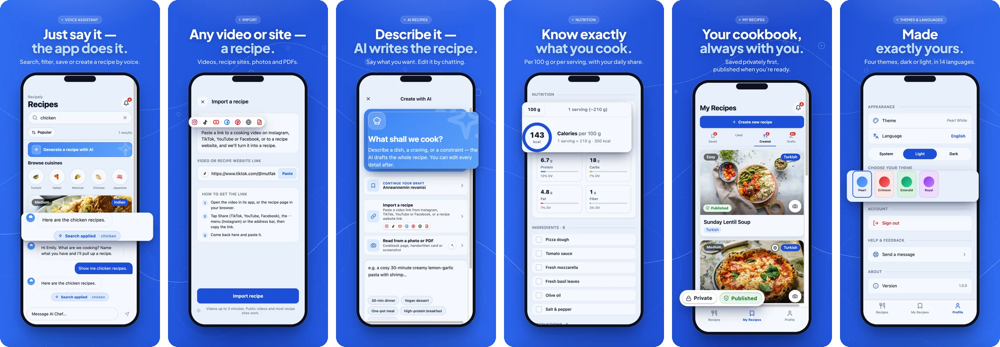
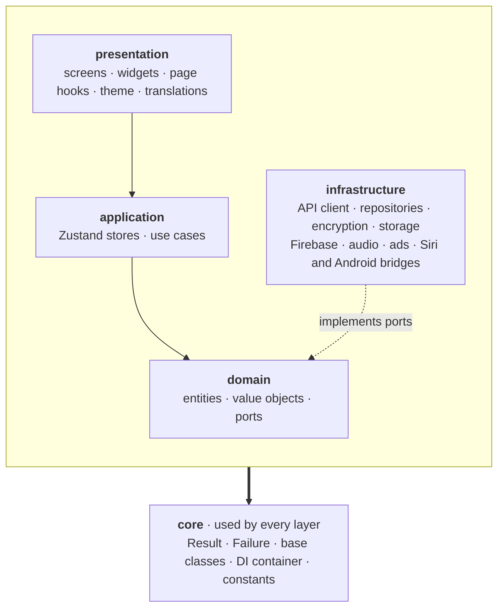

<a id="top"></a>

<div align="center">


# Recipely

### Talk, import, cook.

A recipe app for iOS, Android and the web, built from one codebase.<br/>
Import a recipe from any video, site, photo or PDF, have AI write one for you,<br/>
and cook it with a voice assistant that uses the app on your behalf.

<a href="https://apps.apple.com/us/app/recipely/id6787391255"></a>
&nbsp;
<a href="https://play.google.com/store/apps/details?id=com.recipely.app"></a>

[](https://expo.dev)
[](https://reactnative.dev)
[](https://react.dev/learn/react-compiler)
[](#-checking-your-work)
[](#-checking-your-work)
[](#-license)

[**Website**](https://recipely.net) · [**About**](https://recipely.net/about) · [Features](#-features) · [Architecture](#-how-it-is-built) · [Getting started](#-getting-started) · [Security](#-security)

<br/>



</div>

<br/>

## ✨ Features

<table>
<tr>
<td width="33%" valign="top">

#### 🎙️ Voice assistant
Tap the chef and talk. It searches, filters, opens and creates recipes on screen while you watch, and answers out loud. Siri and Android shortcuts reach it too.

</td>
<td width="33%" valign="top">

#### 📥 Import anything
Share a recipe from Instagram, TikTok, YouTube, Facebook or Pinterest, paste a recipe site, or photograph a cookbook page or a PDF. Every import links back to its source.

</td>
<td width="33%" valign="top">

#### ✨ Create with AI
Describe a dish or list what is in your fridge. AI drafts the recipe and you refine it by chatting.

</td>
</tr>
<tr>
<td valign="top">

#### 🍳 Cook
An ingredient checklist, numbered steps, timers inside the step that mentions them, a cooking mode, and metric or US units.

</td>
<td valign="top">

#### 🛒 Plan and shop
Plan the week from saved recipes and get one shopping list. The list and saved recipes open offline.

</td>
<td valign="top">

#### 📊 Track
A food diary with nutrition per 100 g or per serving, and your daily share of each nutrient.

</td>
</tr>
<tr>
<td valign="top">

#### 🔎 Discover
A recipe feed with search, filters, sorting, cuisines and trending recipes. Guests can browse without an account.

</td>
<td valign="top">

#### ⭐ Creators
Creator pages and tags, stats, and Instagram comment-to-DM recipe delivery.

</td>
<td valign="top">

#### 🌍 Everywhere
Four themes in light and dark, 14 languages, and a web app with its own desktop layout and prerendered recipe pages.

</td>
</tr>
</table>

The app talks to its own API at `api.recipely.net` (the separate `recipely-backend` repository) and uses
Firebase for Google and Apple sign-in, push, analytics and crash reports.

## 🧱 How it is built

Five layers. A layer may use the layers below it, never the ones above, and every layer may use **core**.



| Idea | In practice |
|---|---|
| **Dependencies point down** | A screen never calls the API: it calls a store, which calls a use case, which asks a port. `check:structure` fails a commit that imports the wrong way. |
| **Ask for an interface, get an implementation** | Use cases depend on ports such as `FavoritesRepositoryInterface`; the DI container plugs in the real class at start-up and a fake in tests. |
| **Failures are values** | Business code never throws. Every call that can fail returns `Result<T, Failure>`, and the API sends a message key the app shows in the user's language. |
| **State in stores, rendering compiled** | Components read one slice with `useStore(store, selector)`, and the React Compiler memoizes, so only what changed re-renders. |
| **Rules are checked by machines** | Strictest TypeScript, type-aware lint, about fifty structure rules and coverage minimums run on every commit. |

<details>
<summary><b>The stack</b></summary>
<br/>

| Area | Choice |
|---|---|
| Framework | Expo SDK 57 · React Native 0.86 (New Architecture) · React 19.2 with the React Compiler |
| Language | TypeScript, strict plus `noUncheckedIndexedAccess` and `exactOptionalPropertyTypes` |
| Routing | expo-router (file-based) with a custom route context |
| State | Zustand 5, vanilla stores |
| Network | Axios with an AES-256-GCM envelope, session renewal with single-use refresh tokens |
| Security | TLS with pinned roots, the envelope, Play Integrity and App Attest |
| Web | react-native-web, static export to Firebase Hosting |
| Voice | [`@live-assistant/*`](https://github.com/Recipely-Team/live-assistant) on Gemini Live |
| Tests | Jest + jest-expo (4,512 tests), Playwright and Maestro in `recipely-tests` |

</details>

Pages live in `src/presentation/app/<route>/index.tsx`, with their parts beside them in `body/`, `items/`,
`sheets/`, `hooks/` and `model/`. The full rules, with the reason for each, are in
[`architecture.md`](architecture.md) and [`CLAUDE.md`](CLAUDE.md).

## 🚀 Getting started

You need Node.js 20+ and npm. For iOS, Xcode 16+ and CocoaPods; for Android, Android Studio with JDK 17.

```bash
npm install
npm run start:dev    # Expo dev server against the dev API
npm run web          # in a browser
npm run ios          # simulator or device
npm run android      # emulator or device
```

> [!TIP]
> Simulators, emulators and the browser work for development as they are. They cannot produce an app
> attestation proof, so the app sends none and development servers only log its absence.

<details>
<summary><b>Environment keys</b> for <code>.env.local</code></summary>
<br/>

Every key is `EXPO_PUBLIC_*` because the app reads it on the device; the full list is declared in
[`process-env.d.ts`](process-env.d.ts).

```bash
EXPO_PUBLIC_API_AES_KEY=             # 32-byte hex; must match the backend's API_AES_KEY
EXPO_PUBLIC_API_BASE_URL=            # optional: overrides the per-variant API host
EXPO_PUBLIC_GOOGLE_WEB_CLIENT_ID=    # Firebase → Auth → Google sign-in
EXPO_PUBLIC_FIREBASE_API_KEY=
EXPO_PUBLIC_FIREBASE_APP_ID=
EXPO_PUBLIC_FIREBASE_PROJECT_ID=
EXPO_PUBLIC_FIREBASE_STORAGE_BUCKET=
EXPO_PUBLIC_FIREBASE_MESSAGING_SENDER_ID=
EXPO_PUBLIC_FIREBASE_MEASUREMENT_ID=
EXPO_PUBLIC_FIREBASE_VAPID_KEY=      # web push only
EXPO_PUBLIC_PLAY_INTEGRITY_PROJECT_NUMBER=  # optional: Android attestation
```

> [!WARNING]
> The AES key ships inside every app and the web bundle. It detects tampering; TLS is what keeps
> traffic private. See [`docs/security.md`](docs/security.md).

</details>

<details>
<summary><b>Build variants</b>: development and production side by side</summary>
<br/>

`APP_VARIANT` picks the whole environment, so both variants can sit on one phone.

| | development | production |
|---|---|---|
| Name | Recipely (Dev) | Recipely |
| Android package | `com.recipely.app.dev` | `com.recipely.app` |
| iOS bundle id | `net.recipely.app.dev` | `net.recipely.app` |
| API | `dev-api.recipely.net` | `api.recipely.net` |
| Web | `dev.recipely.net` (team only) | `recipely.net` |

</details>

## ✅ Checking your work

Four commands must pass before a commit, and CI runs them again:

```bash
npm run lint                 # type-aware ESLint, React Compiler rules
npx tsc --noEmit             # TypeScript at its strictest
npx jest --ci --coverage     # tests, with per-layer coverage minimums that only go up
npm run check:structure      # about fifty architecture rules, unused code, unused translations
```

A Husky pre-commit hook runs them on staged files. After adding or moving files, run `npm run map`: it
regenerates [`PROJECT-MAP.md`](PROJECT-MAP.md), and the structure check fails while that file is stale.

> [!IMPORTANT]
> **A bug fix ships the test that would have caught it**: a regression test that fails without the fix,
> a mechanical guard where one is possible, and a row in [`docs/regressions.md`](docs/regressions.md)
> naming the class of mistake.

<details>
<summary><b>Where things are</b></summary>
<br/>

```
src/
  presentation/    app/ (one folder per route), base/ (shared widgets, theme, hooks), i18n/, navigation/, bootstrap/
  application/     stores, use cases, DI registration per feature
  domain/          entities, value objects, ports
  infrastructure/  repositories, DTOs, mappers, HTTP client, crypto, attestation, storage, Firebase, native bridges
  core/            Result, Failure, base classes, DI container, constants
modules/           the native assistant kit (Swift and Kotlin)
plugins/           Expo config plugins: certificate pinning, signing, R8, crash symbols
scripts/           the structure check, project map, typed routes, web export steps
public/            static web pages (about, legal)
```

Path aliases: `@core/*`, `@domain/*`, `@application/*`, `@infrastructure/*`, `@presentation/*`, `@assets/*`.
For anything else, [`PROJECT-MAP.md`](PROJECT-MAP.md) says where each kind of file goes.

</details>

## 📦 Shipping

Work goes feature branch → PR → `dev` → release PR → `main`. `main` is release-only.

| On | CI does |
|---|---|
| Every PR | Lint, type check, tests with coverage |
| `dev` | Deploys the dev web app; mobile builds only when the merge commit's subject asks with `[dist]`, `[dist:android]` or `[dist:ios]` |
| `main` | Tags a version, uploads to Play internal and TestFlight, deploys recipely.net |

Release notes live in `distribution/whatsnew/` and `fastlane/metadata/`, in English and Turkish. The steps
are in [`WORKFLOW.md`](WORKFLOW.md).

## 🔒 Security

| Layer | What it does |
|---|---|
| **TLS, pinned** | Release builds allow no plain HTTP and pin `api.recipely.net` to the Let's Encrypt root keys. |
| **Envelope** | Every JSON body and reply is sealed with AES-256-GCM, so tampering is detected. |
| **Sessions** | Short-lived access tokens; refresh tokens are single-use, stored as hashes on the server, and kept in the Keychain or Keystore on the phone. |
| **App attestation** | Play Integrity (Android) and App Attest (iOS) prove that a costly request came from the genuine app. Built on both sides, switched off until the store set-up is done. |
| **The server decides** | The app's checks are for a good experience; authorisation and limits live in the API. |

The threat model, and what the shipped keys do and do not protect, are in
[`docs/security.md`](docs/security.md). Please report a vulnerability privately to recep@recipely.net
rather than in a public issue.

## 🗺️ Roadmap and contributing

Planned features and engineering work are in [`docs/roadmap.md`](docs/roadmap.md), each with why it
matters and what is still open; released changes are in [`CHANGELOG.md`](CHANGELOG.md).

To contribute, read [`WORKFLOW.md`](WORKFLOW.md) for the steps and [`CLAUDE.md`](CLAUDE.md) for the rules
every change follows: branch from `dev`, keep the four checks green, add a test for every behaviour you
change, and open a PR to `dev`. Questions and bugs go to
[GitHub issues](https://github.com/Recipely-Team/recipely/issues).

## 📄 License

The code is released under the **[GNU AGPL-3.0](LICENSE)**: you may read, run, change and redistribute
it, as long as your version is released under the same licence with its source available to its users,
including over a network.

The name **Recipely**, the logo and the store listings are reserved separately in
[`TRADEMARKS.md`](TRADEMARKS.md). This repository is the client only: the backend is private, and no key
or credential is committed here.

<div align="right"><sub><a href="#top">↑ Back to top</a></sub></div>
