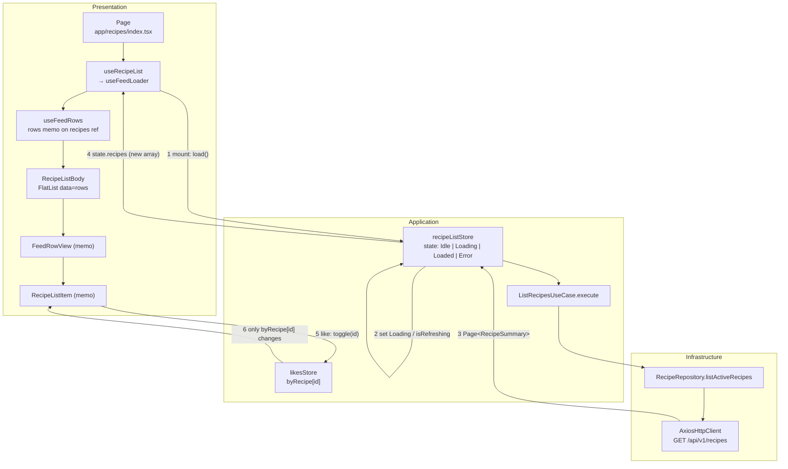

# Recipe feed: request to pixels

How the mobile recipe feed loads, refreshes and reacts to a like, traced from the source on
2026-10-25. Every arrow below is a call or a subscription in the code; line numbers are
indicative.

## Call chain (down)

| Step | File | Call |
|---|---|---|
| Page | `src/presentation/app/recipes/index.tsx` | `const vm = useRecipeList()` (:30), renders `<RecipeListBody vm={vm} />` (:90) |
| Page hook | `src/presentation/app/recipes/hooks/use-recipe-list.ts` | composes `useFeedLoader({ filters, sortBy, debouncedSearch })` (:85) |
| Loader hook | `src/presentation/app/recipes/hooks/use-feed-loader.ts` | `useStore(recipeListStore, s => s.state)` and `s.load` / `s.loadMore` (:49–51); Idle → `load(...)` in an effect |
| Store | `src/application/recipes/list/recipe-list-store.ts` | `load` (:26) sets `Loading`, or `isRefreshing` when already loaded, then `deps.listRecipes.execute(filters)` |
| Wiring | `src/application/di/features/register-recipes.ts` (:66, :71) | `configureRecipeListStore({ listRecipes: new ListRecipesUseCase(recipeRepo) })` |
| Use case | `src/application/recipes/list/list-recipes-use-case.ts` | `execute(filters)` → `repo.listActiveRecipes(filters)` |
| Repository | `src/infrastructure/recipes/recipe-repository.ts` (:66) | `toRecipeListQuery(filters)` → `http.get(ApiRoutes.recipes.root, { params })` → offline `readThrough` on page 1 → `toRecipePage` |
| HTTP | `src/infrastructure/network/http/axios-http-client.ts` | headers + AES envelope; `GET /api/v1/recipes` |

## Return path (up)

1. `toRecipePage` maps DTOs to `RecipeSummaryEntity` (an unreadable row is skipped).
2. The store ignores the answer if a newer load started (`RequestEpoch`); otherwise
   `set({ state: Loaded, recipes: [...items] })`, or `Error` / `refreshFailure` on a failure.
3. `use-recipe-list.ts` (:141) exposes `recipes = state.recipes` only while the loaded answer
   matches the current query.
4. `use-feed-rows.ts` builds `rows` (memoized on the `recipes` reference) and a stable
   `keyExtractor` (recipe id).
5. `RecipeListBody` (`body/recipe-list-body.tsx`) passes `data={rows}` and a stable
   `renderItem` to `FlatList`; it shows `ErrorState` on `Error`.
6. `FeedRowView` (`items/feed-row-view.tsx`, `memo`) renders `RecipeListItem`
   (`items/cards/recipe-list-item.tsx`, `memo`).
7. `RecipeListItem` subscribes to its own like: `useStore(likesStore, s => s.byRecipe[recipe.id])`.

## Diagram

- **Initial load:** 1 → 2 (`Loading`, skeleton) → use case → repository → 3 → 4 (rows built).
- **Refresh:** 2 sets `isRefreshing` and keeps the same `recipes` reference, so `rows` and the
  FlatList rows do not rebuild until 4 brings a new array.
- **Like:** 5 → 6; the store copies other entries by reference, so only that card re-renders.

## Verified by tests

- `src/presentation/app/recipes/items/cards/__tests__/recipe-list-item.like-renders.test.tsx`:
  liking one of eight cards renders that card only.
- `src/application/recipes/list/__tests__/recipe-list-store.test.ts`: `recipes` keeps its
  reference during a refresh and a next page.

## Not verified from the source

- How many times each card renders on the **first** load: each card seeds `likesStore` on mount,
  which probably costs one extra render per card; not measured.
- Native view updates below React (whether React Native skips identical props at the native
  layer); outside this code.
- The web feed (`WebRecipeFeed`) takes a different path below `RecipeListBody` and is not
  covered here.
